**Exercicio 1. Instalación de Apache**:

- Captura 1 - Ficheiro de configuración de Vagrant (paso 2).

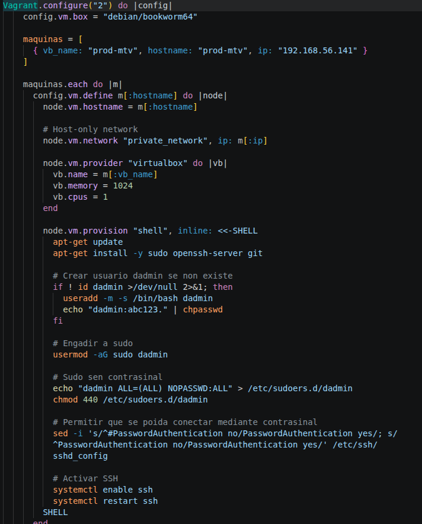

 

- Captura 2 - Comprobación da versión de Apache instalada (paso 7).

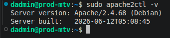

 

- Captura 3 - Páxina por defecto de Apache no navegador (paso 8).

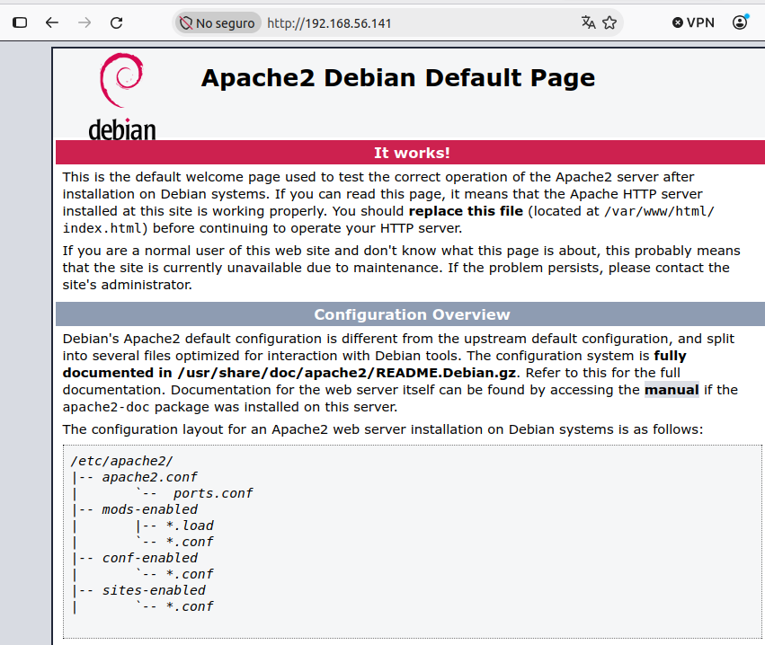

------

**Exercicio 2. Creación de virtualhost**:

- Captura 1 - Definición do `virtualhost` (paso 7).

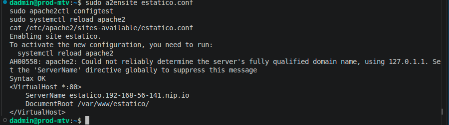

 

- Captura 2 - Comprobación no navegador do funcionamento da web por nome `estatico` (paso 8).

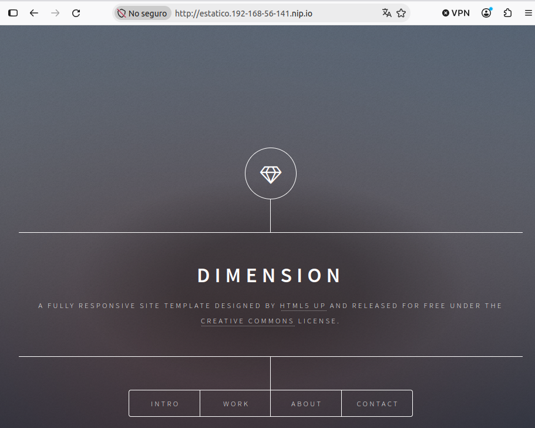

- Captura 3 - Comprobación no navegador do funcionamento da web por IP como `virtualhost` por defecto (paso 10).

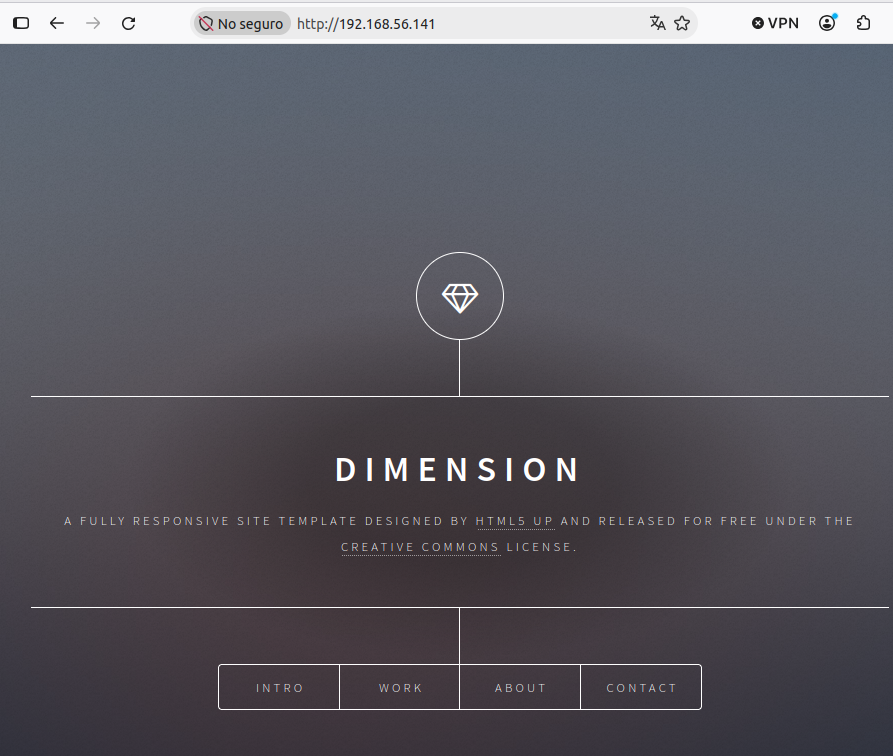

 

------

**Exercicio 3. Directivas máis utilizadas**:

- Captura 1 - Definición do `virtualhost` cos alias (paso 1).

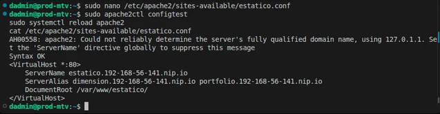 

- Captura 2 - Comprobación no navegador do funcionamento da web por nome `dimension` (paso 3).

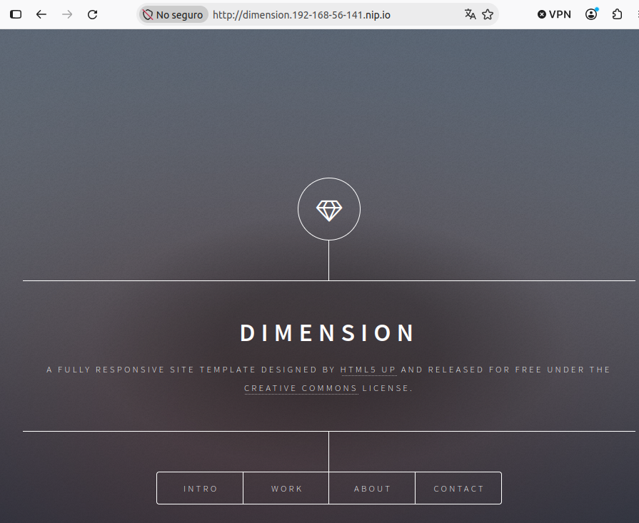

 

- Captura 3 - Comprobación no navegador do funcionamento da web por nome `portfolio` (paso 3).

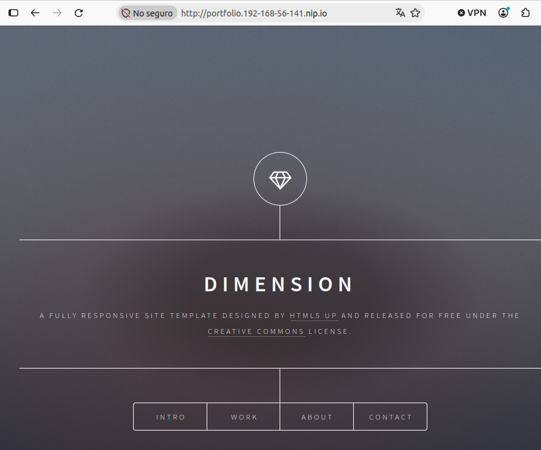 

- Captura 4 - Definición do `virtualhost` cos *logs* (paso 5).

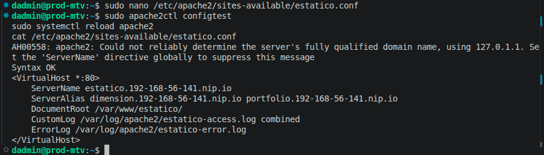 

- Captura 5 - Contido do *log* de acceso (paso 8).

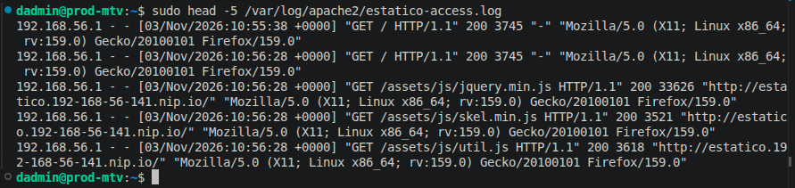 

------

**Exercicio 4. Bloque Directory**:

- Captura 1 - Definición do `virtualhost` co bloque `Directory` para desactivar listar o cartafol, activar os enlaces simbólicos e permitir o acceso a tódolos usuarios (paso 2).

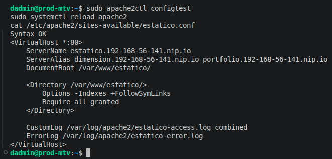 

- Captura 2 - Mensaxe do navegador na URL `http://portfolio.192-168-56-141.nip.io/images/`, onde xa non se listan os ficheiros (paso 4).

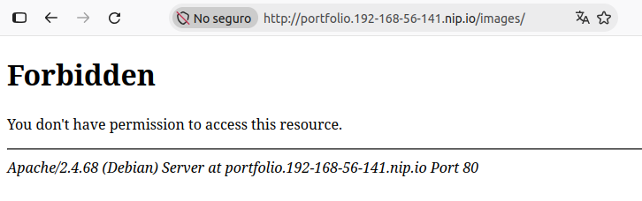

 