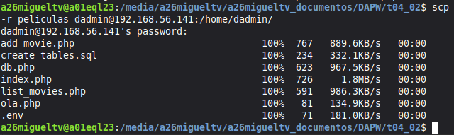
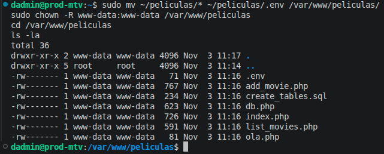
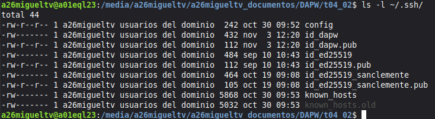
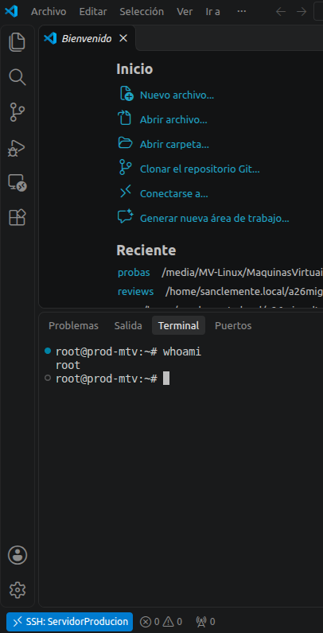
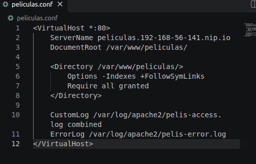
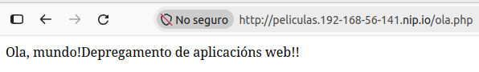

**Exercicio 1. Comando scp**:

- Captura 1 - Saída do comando `scp` ao copiar o directorio completo na máquina virtual (paso 4).

&nbsp;

- Captura 2 - Saída do comando `ls -la` en `/var/www/peliculas/`, onde se vexan os ficheiros ocultos (paso 7).

&nbsp;

---

**Exercicio 2. Acceder por claves pública e privada como root**:

- Captura 1 - Claves pública e privada creadas en `~/.ssh/` (paso 2).

- Captura 2 - VSC conectado por SSH á máquina de produción como `root` cunha terminal aberta (paso 11).

&nbsp;

---

**Exercicio 3. Instalación de PHP para Apache**:

- Captura 1 - Ficheiro de definición do `virtualhost` `peliculas.conf` (paso 5).

&nbsp;

- Captura 2 - Páxina `ola.php` no navegador web (paso 7).

&nbsp;

---

**Exercicio 4. Configuración de base de datos en produción**:

- Captura 1 - Táboas creadas en PHPMyAdmin (paso 7).

&nbsp;

- Captura 2 - Contido do ficheiro `.env` (paso 10).

&nbsp;

- Captura 3 - Contido da táboa `peliculas` dende PHPMyAdmin (paso 11).

&nbsp;

---

**Exercicio 5. Seguridade nas variables de contorno**:

- Captura 1 - Ficheiro de definición do `virtualhost` co bloque `Files` (paso 2).

&nbsp;

- Captura 2 - Navegador coa URL `http://peliculas.192-168-56-141.nip.io/.env`, onde se vexa que o acceso está denegado (paso 4).

&nbsp;
