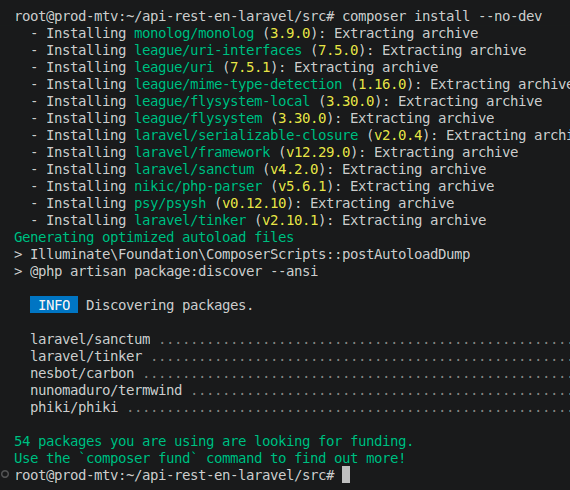
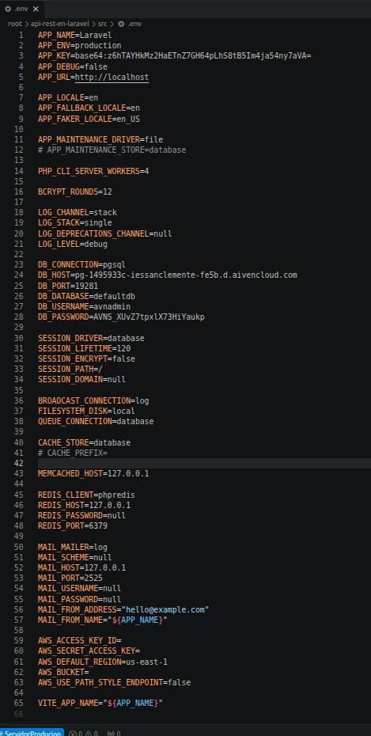

**Exercicio 1. Despregue de aplicación Laravel**:

- Captura 1 - Instalación das dependencias de produción con `Composer` (paso 9).

&nbsp;

- Captura 2 - Ficheiro `.env` completo (paso 14).

&nbsp;

- Captura 3 - Contido da táboa `migrations` dende o cliente de VSC (paso 19).

&nbsp;

- Captura 4 - Comprobación con `ls -la` de que tódolos ficheiros, incluídos os ocultos, están en `/var/www/laravel` (paso 23).

&nbsp;

- Captura 5 - Ficheiro de definición do `virtualhost` `api.conf` (paso 25).

&nbsp;

- Captura 6 - Páxina principal de Laravel en funcionamento (paso 28).

&nbsp;

- Captura 7 - Resposta do navegador en `http://api.192-168-56-141.nip.io/api/libros` tras activar `mod_rewrite` e `AllowOverride All` (paso 33).

&nbsp;

- Captura 8 - Execución e saída do comando `cURL` para crear un libro (paso 34).

&nbsp;

- Captura 9 - Execución e saída do comando `cURL` para ver tódolos libros (paso 35).

&nbsp;

---

**Exercicio 2. Actualización de aplicación Laravel**:

- Captura 1 - Execución e saída do comando `cURL` para crear un disco (paso 12).

&nbsp;

- Captura 2 - Execución e saída do comando `cURL` para ver tódolos discos (paso 13).

&nbsp;
